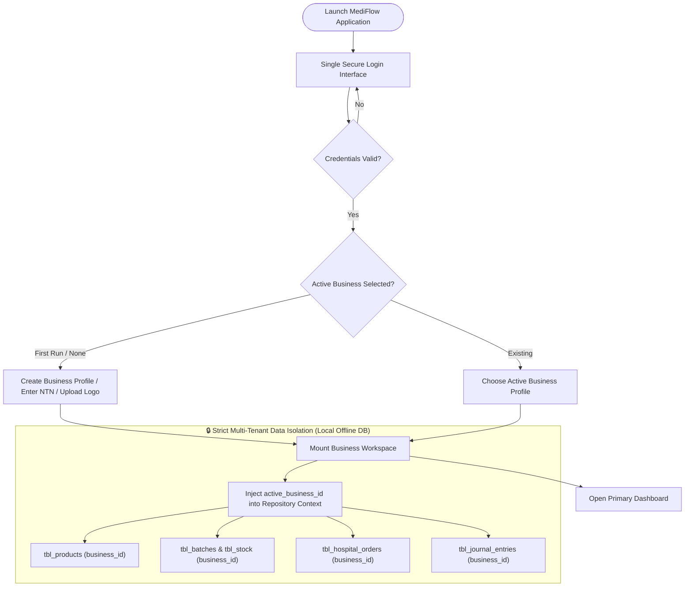
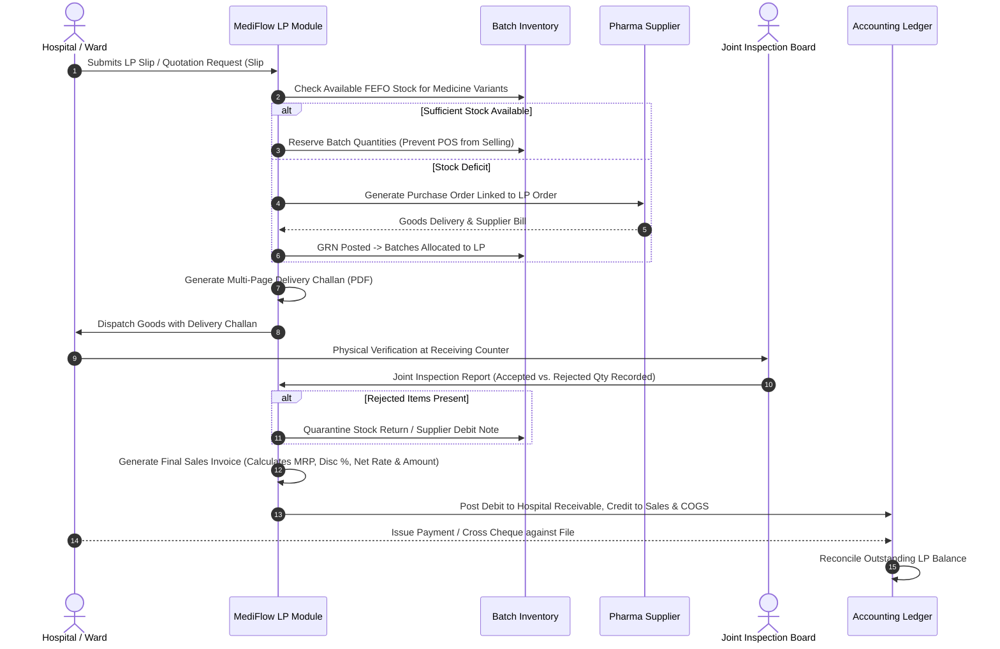
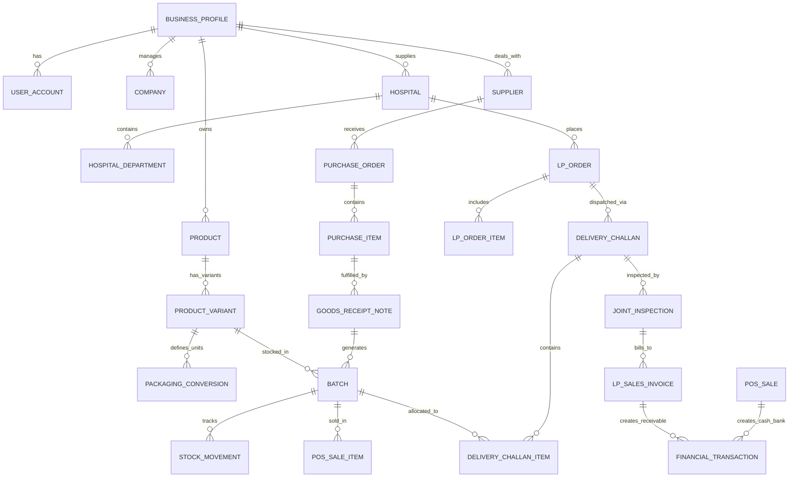
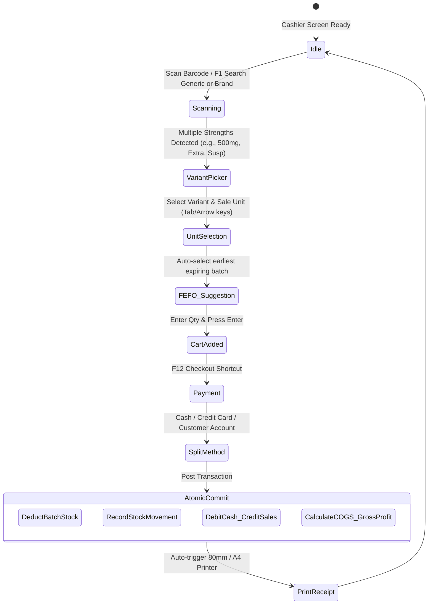
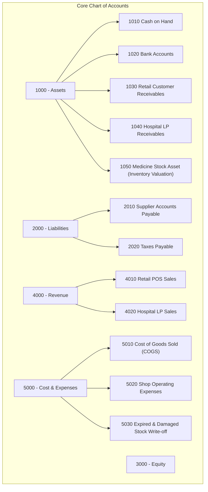
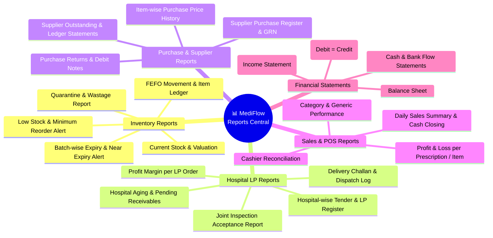
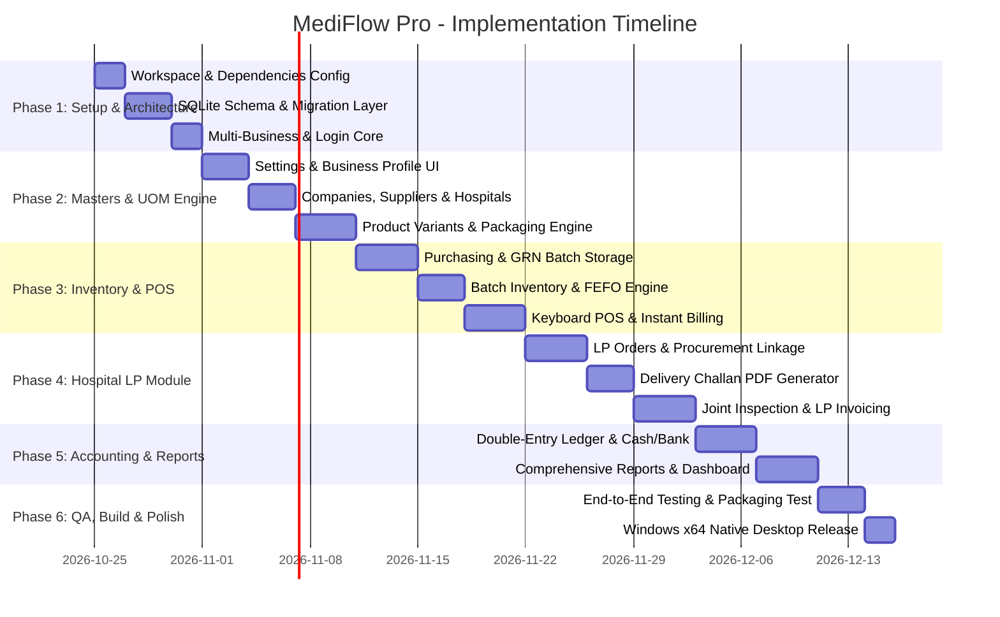

# 🏥 MediFlow Pro & MedSupply PK — Master Architectural Blueprint & Implementation Plan
### Complete Pharmacy, Medical Store, Multi-Variant Inventory, POS, Double-Entry Accounting & Hospital LP Supply Management Desktop Suite

---

## Executive Summary & Vision

This blueprint outlines the full architectural specification and execution roadmap for **MediFlow Pro**, a production-grade, offline-first Flutter Windows desktop software. The application is uniquely architected to handle the dual business model prevalent in the Pakistani pharmaceutical market:
1. **High-Velocity Retail Pharmacy & POS:** Over-the-counter and prescription sales, fractional packaging breakdown (Carton → Box → Strip → Tablet), FEFO batch control, barcode scanning, and instant cash closing.
2. **Institutional Hospital LP (Local Purchase) Supply:** Multi-department hospital tender/LP lifecycle management, direct procurement against LP, batch reservations, multi-page delivery challans, joint inspection reports, and institutional credit invoicing strictly matching real-world Sindh/Punjab public healthcare templates (e.g., SMBB Institute of Trauma, Karachi).

---

## 1. High-Level Architecture & System Topology

```mermaid
graph TB
    subgraph ClientLayer["🖥️ Presentation Layer (Flutter Desktop - Win32/x64)"]
        UI_Nav["Sidebar & Global Navigation Hub"]
        UI_POS["⚡ High-Speed Keyboard POS"]
        UI_LP["🏥 Hospital LP Tender & Supply Hub"]
        UI_Stock["📦 Variant & Batch Stock Manager"]
        UI_Acct["💰 Accounting & Ledger Central"]
        UI_Reports["📊 Analytics & Document Printing (PDF/Excel)"]
    end

    subgraph StateLayer["⚡ Application Logic & State Layer (Bloc / Riverpod)"]
        BL_Auth["Single-Login & Multi-Business Controller"]
        BL_Packaging["Unit Conversion & Fraction Engine"]
        BL_FEFO["FEFO Batch & Expiry Optimizer"]
        BL_LP["Hospital Order State Machine"]
        BL_Finance["Double-Entry Ledger & Balance Calculator"]
    end

    subgraph DomainLayer["⚙️ Domain Services & Business Rules"]
        SRV_Inventory["Stock Movement & Valuation Service (FIFO/Actual)"]
        SRV_Procure["Purchase & Goods Receipt Note (GRN) Service"]
        SRV_LP["Challan, Joint Inspection & Invoicing Pipeline"]
        SRV_Doc["Template-Accurate PDF & Thermal Print Renderer"]
        SRV_Backup["Automated Snapshot & Disaster Recovery Engine"]
    end

    subgraph PersistenceLayer["💾 Persistence Layer (Local SQLite Engine)"]
        DB_Driver["sqflite_common_ffi (Encrypted / WAL Mode)"]
        DB_Schema["Strict Relational Schema (32+ Normalized Tables)"]
        DB_Trx["Atomic Transactions & Audit Log Journals"]
    end

    ClientLayer --> StateLayer
    StateLayer --> DomainLayer
    DomainLayer --> PersistenceLayer
```



---

## 2. Multi-Business Profile & Single-Login Architecture



### Key Data Isolation Rules
1. **Zero Data Bleed:** Every primary query contains `WHERE business_id = ?`.
2. **Document Header Immutability:** Historical invoices and challans record the snapshot of business legal name, NTN, STRN, and address at time of issue.
3. **No Hardcoding:** Business details, hospitals, suppliers, manufacturers, and formulas are 100% database driven.

---

## 3. Product Variant & Multi-Level Packaging Mathematical Engine

Pharmaceutical products in Pakistan have distinct strengths, dosage forms, and varying unit conversions. For example:
- **Panadol:** 500mg Tablet vs. Panadol CF vs. Panadol Elixir 120ml.
- **Conversion Example:**
  - 1 Carton = 24 Boxes
  - 1 Box = 10 Strips
  - 1 Strip = 10 Tablets
  - $\rightarrow$ Base Unit = 1 Tablet (Total Base Qty in Carton = $24 \times 10 \times 10 = 2,400$ Tablets).

```mermaid
graph LR
    subgraph PackagingHierarchy["Hierarchical Packaging Tree"]
        C[Carton<br>Factor: 2400] -->|x24| B[Box<br>Factor: 100]
        B -->|x10| S[Strip<br>Factor: 10]
        S -->|x10| T[Tablet / Capsule<br>Factor: 1 (Base Unit)]
    end

    subgraph LiquidHierarchy["Simple / Liquid Hierarchy"]
        Bottle[Bottle / Pack<br>Factor: 120] -->|x120| ML[Millilitre (ml)<br>Factor: 1 (Base Unit)]
    end
```

### Mathematical Conversion Equations
Let $U_1, U_2, \dots, U_k$ be packaging levels from largest to smallest ($U_k$ is base unit with factor $f_k = 1$).
- **Conversion Factor:**
  $$f_i = \prod_{j=i}^{k-1} \text{multiplier}_j$$
- **Deduction upon selling quantity $Q$ of level $U_i$:**
  $$\Delta \text{BaseStock} = Q \times f_i$$
- **Pretty-Print Decomposition (e.g. 5,345 tablets):**
  $$\text{Cartons} = \lfloor 5345 / 2400 \rfloor = 2 \quad (\text{rem } 545)$$
  $$\text{Boxes} = \lfloor 545 / 100 \rfloor = 5 \quad (\text{rem } 45)$$
  $$\text{Strips} = \lfloor 45 / 10 \rfloor = 4 \quad (\text{rem } 5)$$
  $$\text{Tablets} = 5$$
  $$\mathbf{\text{Display: } \text{"2 Cartons, 5 Boxes, 4 Strips, 5 Tablets"}}$$

---

## 4. Complete Hospital LP (Local Purchase) Supply Chain Workflow

The application precisely implements the operational flow seen in Pakistani tertiary care hospitals (e.g., SMBB Trauma Centre, Civil Hospital, JPMC):



---

## 5. Document Reproduction Matching Provided PDF Templates

The three provided PDF documents in the project folder have been reverse-engineered down to typography, header layouts, borders, and column data structures:

### Comparative Template Specification Matrix

| Feature / Field | Delivery Challan (`Delevry challan.pdf`) | Joint Inspection Report (`Joint_inspection_report.pdf`) | Sales Invoice (`Sales invoice.pdf`) |
| :--- | :--- | :--- | :--- |
| **Top Title** | `MEDICAL CORPORATION` (Configurable) | `MEDICAL CORPORATION` (Configurable) | `MEDICAL CORPORATION` (Configurable) |
| **Document Label** | `DELIVERY CHALAN` (Navy bordered box) | `JOINT INSPECTION REPORT` (Navy bordered box) | `INVOICE` (Navy bordered box) |
| **Top Meta** | M/S Hospital Name, Address, NTN | M/S Hospital Name, Address, NTN | M/S Hospital Name, Address, NTN |
| **Right Meta** | `FILE #: 3.002.00`, `DATE: 02-Mar-2026` | `FILE #: 3.002.00`, `DATE: 02-Mar-2026` | `FILE #: 3.002.00`, `DATE: 02-Mar-2026` |
| **Column 1** | `Sr#` | `Sr#` | `Sr#` |
| **Column 2** | `DATE / SLIP #` (e.g. `02-Mar-2026 / 002544`) | `DATE / SLIP #` (e.g. `02-Mar-2026 / 002544`) | `DATE / SLIP #` (e.g. `02-Mar-2026 / 002544`) |
| **Column 3** | `REQUESTED DEPARTMENT` | `REQUESTED DEPARTMENT` | `REQUESTED DEPARTMENT` |
| **Column 4** | `ITEM GENERIC` | `ITEM GENERIC` | `ITEM GENERIC` |
| **Column 5** | `REQ. QTY.` | `REQ. QTY.` | `REQ. QTY.` |
| **Column 6** | `SUPPLIED ITEM NAME` (Brand/Strength) | `SUPPLIED ITEM NAME` (Brand/Strength) | `SUPPLIED ITEM NAME` (Brand/Strength) |
| **Column 7** | `SUP. QTY.` | `SUP. QTY.` | `SUP. QTY.` |
| **Pricing Columns** | *None (Blank verification columns)* | *Inspection checkboxes & Remarks* | `M.R.P. /PCS` \| `DISC. %` \| `NET RATE` \| `NET AMOUNT` |
| **Bottom Totals** | Dispatched Summary & Signature lines | Accepted/Rejected summary & 3 Signatures | **Grand Totals:** Total MRP & Total Net Amount (e.g. `141,742.70 PKR`) |

---

## 6. Entity Relationship Diagram (Database Schema)



---

## 7. Fast Keyboard-Driven Retail POS Workflow



---

## 8. Double-Entry Accounting & Financial Ledger Engine

To provide reliable financial tracking, MediFlow uses a clean, standardized chart of accounts:



### Standard Transaction Journal Rules:
1. **Purchase Goods Posted:**
   - Debit: `1050 Medicine Stock Asset`
   - Credit: `2010 Supplier Accounts Payable`
2. **Retail Sale Completed:**
   - Debit: `1010 Cash on Hand` (or `1020 Bank`)
   - Credit: `4010 Retail POS Sales`
   - *Simultaneous COGS Entry:*
     - Debit: `5010 Cost of Goods Sold` (based on batch actual purchase cost)
     - Credit: `1050 Medicine Stock Asset`
3. **Hospital LP Invoice Billed:**
   - Debit: `1040 Hospital LP Receivables (Specific Hospital & File #)`
   - Credit: `4020 Hospital LP Sales`
4. **Hospital Payment Received:**
   - Debit: `1020 Bank Account`
   - Credit: `1040 Hospital LP Receivables`

---

## 9. Comprehensive Reports & Analytics Suite



---

## 10. Phased Step-by-Step Implementation Roadmap



### Milestone Deliverables Summary:
- **Phase 1:** Core database with 32+ normalized tables, foreign key constraints, migration engine, and session management.
- **Phase 2:** Product variant generator, brand association, and multi-tier recursive packaging conversion engine with validation.
- **Phase 3:** Full batch lifecycle with actual unit cost valuation, barcode detection, and high-speed POS.
- **Phase 4:** Exact replica of the 3 hospital document templates (`Delevry challan.pdf`, `Joint_inspection_report.pdf`, `Sales invoice.pdf`) generating pixel-perfect multi-page printable PDFs.
- **Phase 5:** Automated double-entry financial posting and real-time operational dashboard with interactive charts.
- **Phase 6:** Offline backup/restore engine, release build verification on Windows 10/11 desktop.

---

## 11. Technology Stack & Package Compatibility

| Component | Selected Technology | Purpose & Justification |
| :--- | :--- | :--- |
| **Framework** | **Flutter Desktop (Windows x64)** | High performance, native 60fps desktop rendering, clean UI/UX |
| **Local Database** | `sqflite_common_ffi` | Standard ACID-compliant SQLite engine for Windows desktop |
| **State Management**| `flutter_bloc` or `riverpod` | Predictable state machines for POS and LP order states |
| **PDF Generation** | `pdf` & `printing` | Pixel-perfect programmatic vector PDF generation matching sample forms |
| **Excel Export** | `syncfusion_flutter_xlsio` / `excel` | Native .xlsx spreadsheet generation without cloud dependencies |
| **Charts & Graphs**| `fl_chart` | Smooth, modern interactive dashboard trends and stock charts |
| **Icons & UI** | `lucide_icons` / `fluent_ui` | Clean, modern clinical and accounting design aesthetics |
| **Localization** | `intl` | Pakistani Rupee (`PKR`, `Rs.`), local number grouping, and date formats |
